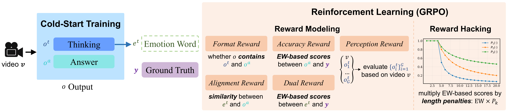

<h3 align="center"><a href="https://arxiv.org/pdf/2605.06126" style="color:#9C276A">
AffectGPT-RL: Revealing Roles of Reinforcement Learning
in Open-Vocabulary Emotion Recognition</a></h3>

<h5 align="center">
Zheng Lian, Fan Zhang, Lan Chen, Yazhou Zhang, Rui Liu, Jinyang Wu, Haoyu Chen, Xiaobai Li, Xiaojiang Peng, Bin He, Jianhua Tao
</h5>

<h5 align="center"> 📄 Paper: <a href="https://arxiv.org/pdf/2605.06126">arXiv</a> · <code>paper/NeurIPS_2026__AffectGPT_RL.pdf</code> </h5>

<h5 align="center"> If our project helps you, please give us a star ⭐ on GitHub to support us. 🙏🙏 </h5>

<p align="center"></p>

## 📖 Overview

<div align="center">
<table width="600"><tr><td>

**Open-Vocabulary Multimodal Emotion Recognition (OV-MER)** removes the restriction of a predefined label space, enabling fine-grained emotion understanding. Instead of relying on discriminative classifiers, OV-MER uses generative models to capture the full spectrum of emotions, and evaluates them with **emotion wheels (EWs)**. Existing approaches are trained with a *token-level* loss, which is **misaligned** with the metrics actually used in OV-MER: *joyful* and *awful* share high token-level similarity yet are semantically far apart. Worse, EW-based metrics are **non-differentiable** — they involve stochastic sampling, discrete word-to-word clustering, and set-cardinality operations — so they cannot be optimized by gradient backpropagation at all. **AffectGPT-RL** addresses this with reinforcement learning, which can optimize non-differentiable objectives. EW-based metrics are used as **reward functions**, so that the training objective is directly aligned with the evaluation metric. Extensive experiments reveal the role of reinforcement learning in this task.

</td></tr></table>
</div>

## 🔥 Highlights

<div align="center">
<table width="600"><tr><td>

• **(Framework)** This is the first work to reveal the role of reinforcement learning in OV-MER.

• **(Experiment)** We conduct systematic experiments, revealing the role of the reasoning process, the impact of different rewards, and the generalization of reinforcement learning to other tasks.

• **(Performance)** Our method achieves state-of-the-art performance on fine-grained and basic emotion recognition, highlighting the potential of reinforcement learning in affective computing.

</td></tr></table>
</div>

<p align="center"></p>

<div align="center">
<table width="600"><tr><td>

**Pipeline.** Training has two phases. In the *cold-start* phase we use a large-scale, coarse-grained dataset to build emotion understanding and output-format alignment. In the *RL* phase we use a high-quality, fine-grained dataset for reward calculation and policy updates.

[run-release.sh](run-release.sh) collects the whole release as **five commands in four stages**: **Stage 0** sets up the environment and prepares the data, **Stage 1** (cold start) and **Stage 2** (RL) each run a training instance followed by an inference instance, and **Stage 3** computes the emotion-wheel score. The **[Reproduction](#-reproduction)** section below documents exactly these instances.

</td></tr></table>
</div>

## 🛠️ Requirements and Installation

<div align="center">
<table width="600"><tr><td>

Validated environment — every command in [run-release.sh](run-release.sh) was run in the conda env **`vllm3`** (we have not tested other envs):
* python == 3.10.15
* pytorch == 2.8.0+cu129 (CUDA runtime 12.9), on a single NVIDIA L40 (48 GB)
* vllm == 0.11.0
* transformers == 4.53.2
* tokenizers == 0.21.4
* trl == 0.19.1

The RL models import `trl`, and [statistic.py](statistic.py) imports `vllm` to turn the generated sentences into open-vocabulary labels, so both go in alongside the regular AffectGPT dependencies. Nothing has to be compiled: `vllm` ships its own attention kernels, so there is no `flash-attn` build step.

</td></tr></table>
</div>

```bash
conda create -n vllm3 python=3.10.15
conda activate vllm3

# 1) torch first: vLLM 0.11.0 pins torch==2.8.0 / torchvision==0.23.0 / torchaudio==2.8.0,
#    so the CUDA build has to be chosen explicitly here
pip install torch==2.8.0 torchvision==0.23.0 torchaudio==2.8.0 \
            --index-url https://download.pytorch.org/whl/cu129

# 2) vLLM (this also pulls xformers==0.0.32.post1)
pip install vllm==0.11.0

# 3) transformers LAST: vllm 0.11.0 declares transformers>=4.55.2 while the validated env pins
#    4.53.2. Installing it after vllm stops pip from upgrading it back; `pip check` will still
#    report this single conflict, which is expected.
pip install transformers==4.53.2 tokenizers==0.21.4 trl==0.19.1 peft==0.15.2

# 4) the remaining AffectGPT dependencies
pip install decord einops omegaconf webdataset pytorchvideo timm opencv-python \
            pandas scikit-learn scipy openpyxl tqdm matplotlib seaborn \
            iopath ftfy regex PyYAML sentencepiece protobuf
```

Sanity check — the versions that matter, plus a visible GPU:

```bash
python -c "import torch, vllm, transformers; \
           print(torch.__version__, torch.version.cuda, torch.cuda.is_available(), \
                 vllm.__version__, transformers.__version__)"
# 2.8.0+cu129 12.9 True 0.11.0 4.53.2
```

On the CUDA build: the validated machine's driver is 570.195.03, which reports CUDA 12.8, and it runs the `cu129` wheels as they are — CUDA 12.x minor-version compatibility means any driver that supports 12.0 or later runs the whole 12.x line. If your driver predates 525, pick the matching `--index-url` from the [PyTorch wheel index](https://download.pytorch.org/whl/) instead.

<div align="center">
<table width="600"><tr><td>

**[Environment Preparation]** All paths are hard-coded in [config.py](config.py). `REPO_ROOT` is derived from the file's own location, and `EMOTION_WHEEL_ROOT` / `DATA_DIR` already point inside this repository, so only these entries need repointing:

* `PATH_TO_LLM`, `PATH_TO_VISUAL`, `PATH_TO_AUDIO` — Qwen2.5-7B-Instruct, CLIP ViT-L/14 and chinese-hubert-large.
* `BERT_BASE_UNCASED` — the `bert-base-uncased` directory used by the Q-Former text encoder.
* `PATH_TO_RAW_VIDEO`, `PATH_TO_RAW_AUDIO`, `PATH_TO_RAW_FACE`, `PATH_TO_TRANSCRIPTIONS` — the media roots and the subtitle csv; all three datasets share one root.
* `PATH_TO_LABEL` — the per-dataset open-vocabulary label csvs, read from `dataset/` inside this repository.

</td></tr></table>
</div>

## 🚀 Dataset&Model Preparation

### Dataset Preparation

| Dataset | # Samples | Role | Emotion Task |
|:--------|:---------:|:-----|:-------------|
| MER-Caption+ | 31,327 | **Stage 1**: cold-start training | Open-vocabulary + Descriptive |
| MER2025-OV | 1,000 | **Stage 2**: reinforcement learning | Open-vocabulary |
| OV-MERD+ | 532 | Testing | Open-vocabulary |
| MER-UniBench | 12,799 | Testing | Sentiment + Basic + Open-vocabulary |

<div align="center">
<table width="600"><tr><td>

The label files ship with the repository, so only the **raw media** has to be downloaded. Two options, as in [run-release.sh](run-release.sh):

* **[Option 1]** download all of [MERChallenge/MER2025](https://huggingface.co/datasets/MERChallenge/MER2025).
* **[Option 2]** download only `*/*_track2_train_human` and `*/*_track2_train_mercaptionplus` from [MERChallenge/MER2026](https://huggingface.co/datasets/MERChallenge/MER2026).

Either way, keep everything under `dataset/`: the `audio/`, `video/` and `openface_face/` folders, all subtitles in `subtitle_chieng.csv`, and all the label files — the three training parts `mercaptionplus-emotion.csv`, `mercaptionplus-description.csv` and `mer2025ov1000-emotion.csv`, plus the evaluation labels `ovmerdplus-emotion.csv` — next to them.

</td></tr></table>
</div>

### Model Preparation
<table width="900">
  <tr>
    <th width="32%" align="left">Model Name</th>
    <th width="68%" align="left">Model Type</th>
  </tr>
  <tr>
    <td><a href="https://huggingface.co/openai/clip-vit-large-patch14">clip-vit-large-patch14</a></td>
    <td>Visual Encoder</td>
  </tr>
  <tr>
    <td><a href="https://huggingface.co/TencentGameMate/chinese-hubert-large">chinese-hubert-large</a></td>
    <td>Audio Encoder</td>
  </tr>
  <tr>
    <td><a href="https://huggingface.co/Qwen/Qwen2.5-7B-Instruct">Qwen2.5-7B-Instruct</a></td>
    <td>LLM</td>
  </tr>
  <tr>
    <td><a href="https://huggingface.co/google-bert/bert-base-uncased">bert-base-uncased</a></td>
    <td>Text Encoder / Tokenizer of the Q-Formers</td>
  </tr>
  <tr>
    <td><a href="https://pan.baidu.com/s/1jc7oD6Z1vlUq6r3Wfb5_eg?pwd=ifpg">mercaptionplus_<wbr>outputhybird_<wbr>bestsetup_<wbr>bestfusion_<wbr>face_<wbr>r1stage1</a></td>
    <td><b>Stage 1 (cold start)</b>: trained on <b>MER-Caption+</b> with pre-extracted <b>face</b> as input</td>
  </tr>
  <tr>
    <td><a href="https://pan.baidu.com/s/11LfKslZA2KMoLCRwkKtnVA?pwd=45jk">mercaptionplus_<wbr>outputhybird_<wbr>bestsetup_<wbr>bestfusion_<wbr>face_<wbr>r1stage2_<wbr>mer25ov1000_<wbr>continue60_<wbr>g4_<wbr>formatbeta00_<wbr>ovlabel_<wbr>numrestrict3</a></td>
    <td><b>Stage 2 (RL)</b>: GRPO optimization on MER2025-OV (<i>P</i><sub>3</sub> length penalty), continued from the Stage-1 epoch-60 checkpoint</td>
  </tr>
</table>

### Data and Pre-trained Checkpoints Structure
```bash
dataset # read through config.DATASET_ROOT, which resolves to dataset/ inside this repository
├── mercaptionplus-emotion.csv # MER-Caption+ open-vocabulary labels, 31,327 samples
├── mercaptionplus-description.csv # MER-Caption+ descriptions / reasoning, 31,327 samples
├── mer2025ov1000-emotion.csv # MER2025-OV: the open-vocabulary labels used for RL, 1,000 samples
├── ovmerdplus-emotion.csv # OV-MERD+ ground-truth labels, 532 samples
├── subtitle_chieng.csv # all subtitles (Chinese + English)
├── audio/ # ← download: pre-extracted audio
├── openface_face/ # ← download: pre-extracted face files
└── video/ # ← download: raw videos

AffectGPT-RL
├── emotion_wheel # already included in this repository
├── models # Available at: https://pan.baidu.com/s/1IvC4H7Xt1AzMFocGMBBbHQ?pwd=hzf9
│   ├── chinese-hubert-large # audio encoders
│   ├── clip-vit-large-patch14 # video encoders
│   ├── Qwen2.5-7B-Instruct # LLM
│   └── bert-base-uncased # text encoder / tokenizer of the Q-Formers
└── output # created by train.py; the two pre-trained checkpoints are placed here before Stage 2 / inference
    ├── mercaptionplus_outputhybird_bestsetup_bestfusion_face_r1stage1
    │   └── mercaptionplus_outputhybird_bestsetup_bestfusion_face_r1stage1_20250715180
    └── mercaptionplus_outputhybird_bestsetup_bestfusion_face_r1stage2_mer25ov1000_continue60_g4_formatbeta00_ovlabel_numrestrict3
        └── mercaptionplus_outputhybird_bestsetup_bestfusion_face_r1stage2_mer25ov1000_continue60_g4_formatbeta00_ovlabel_numrestrict3_20251009171
```

## 🏃 Reproduction

<div align="center">
<table width="600"><tr><td>

[run-release.sh](./run-release.sh): **Stage 0** prepares the environment and the data, and **Stages 1–3** run **five commands**.

</td></tr></table>
</div>

| Stage | Commands | What it does |
|:-----:|:--------:|:-------------|
| **Stage 0** | — | Dataset and model preparation — see [Dataset&Model Preparation](#-datasetmodel-preparation) above |
| **Stage 1** | `[1]`–`[2]` | Cold start — train the model to produce output in `<think></think><answer></answer>` format, then run inference |
| **Stage 2** | `[1]`–`[2]` | Reinforcement learning — align the token-level training loss with the semantic-level evaluation metric, then run inference |
| **Stage 3** | `statistic.py` | Score calculation — the emotion-wheel metric over the inference results |

---

### Stage 1: Cold Start
*"train the model to produce output in `<think></think><answer></answer>` format"*

<div align="center">
<table width="600"><tr><td>

We use MER-Caption+, a **large-scale** dataset, to equip the model with emotion understanding and format alignment. Because descriptive emotion datasets already follow a reasoning-like format, we treat the *description* as the thinking $o^t$ and the *open-vocabulary labels* as the answer $o^a$, unifying descriptive and open-vocabulary emotions into a single task. The released configuration uses `label_type: hybird`, i.e. each sample is rendered as a description, a bare OV label set, or a reasoning trace followed by an answer.

</td></tr></table>
</div>

#### [1] Training
```bash
CUDA_VISIBLE_DEVICES=0 python train.py \
  --cfg-path=train_configs/mercaptionplus_outputhybird_bestsetup_bestfusion_face_r1stage1.yaml
```

#### [2] Inference
Evaluates the Stage-1 checkpoints on OV-MERD+ (`OVMERDPlus`), every 5 epochs from 10 to 60:
```bash
CUDA_VISIBLE_DEVICES=0 python inference_hybird.py --zeroshot --dataset='OVMERDPlus' \
  --outside_user_message="Please recognize all possible emotional states of the character." \
  --cfg-path=train_configs/mercaptionplus_outputhybird_bestsetup_bestfusion_face_r1stage1.yaml \
  --options "inference.test_epochs=10-60" "inference.skip_epoch=5"
```

---

### Stage 2: Reinforcement Learning
*"align the token-level training loss with the semantic-level evaluation metric"*

<div align="center">
<table width="600"><tr><td>

We use MER2025-OV, a **high-quality** dataset, for reward calculation and policy updates. Policy optimization follows **GRPO**: $G$ outputs are sampled for each prompt, and rewards are normalized within the group to produce relative advantages. The reward is the emotion-wheel metric itself, so this stage directly optimizes what is measured at test time.

</td></tr></table>
</div>

#### [1] Training
```bash
CUDA_VISIBLE_DEVICES=0 python train.py \
  --cfg-path=train_configs/mercaptionplus_outputhybird_bestsetup_bestfusion_face_r1stage2_mer25ov1000_continue60_g4_formatbeta00_ovlabel_numrestrict3.yaml
```

Key options in this config:

| Option | Value | Meaning |
|:-------|:-----:|:--------|
| `model.arch` | length-penalized GRPO policy | Policy without a reference model, with the $P_3$ (log) length penalty |
| `model.continue_epoch` | `60` | Continue from the Stage-1 epoch-60 checkpoint (located automatically under `output/`) |
| `model.num_generations` | `4` | Number of rollouts sampled per prompt (group size *G*) |
| `model.beta` | `0` | Weight of the KL term. The released arch is reference-free, so no KL term is computed at all |
| `model.formatbeta` | `0.0` | Weight of the format reward. In the released arch the reward reduces to the accuracy reward alone |
| `datasets.mer25ov1000.label_type` | `ovlabel` | Train on the open-vocabulary labels of the 1,000 RL samples |

#### [2] Inference
Evaluates the RL checkpoints on OV-MERD+ every 5 epochs, from epoch 5 to epoch 60 — the range validated by `run-release.sh`:
```bash
CUDA_VISIBLE_DEVICES=0 python inference_hybird.py --zeroshot --dataset='OVMERDPlus' \
  --outside_user_message="Please recognize all possible emotional states of the character." \
  --cfg-path=train_configs/mercaptionplus_outputhybird_bestsetup_bestfusion_face_r1stage2_mer25ov1000_continue60_g4_formatbeta00_ovlabel_numrestrict3.yaml \
  --options "inference.test_epochs=5-60" "inference.skip_epoch=5"
```

<div align="center">
<table width="600"><tr><td>

**Variants.** Three length penalties $P_1$, $P_2$, $P_3$ were explored as separate architectures; this release ships only the loosest one, $P_3$, as [my_affectgpt/models/affectgpt_r1_noref_ovlabel4.py](my_affectgpt/models/affectgpt_r1_noref_ovlabel4.py), which is what the released Stage-2 config `..._numrestrict3.yaml` selects. The $P_1$/$P_2$ and multi-reward variants are not part of this release.

</td></tr></table>
</div>

---

### Stage 3: Score Calculation

Runs both stages of scoring at once, over the results of every stage above:
```bash
CUDA_VISIBLE_DEVICES=0 python statistic.py
```

<div align="center">
<table width="600"><tr><td>

Inference results land in `output/results-{dataset}/{run_name}/`, one `.npz` file per epoch. The reward optimized during Stage 2 and the final metric are the **same** emotion-wheel (EW) measure — both call `wheel_metric_calculation(..., level='level1')` in [my_affectgpt/evaluation/ew_metric.py](my_affectgpt/evaluation/ew_metric.py), which clusters prediction and ground truth onto five emotion wheels and averages the per-wheel F1. Scoring goes through three steps:

1. **The generated sentence is not a label set yet.** The model answers with a natural-language sentence (`The character's emotional state is ...`), so `main_zeroshot_scores` first calls Qwen2.5 (via vLLM) to extract the bare emotion words from each response, then maps every word to the emotion wheel along `word → base form → synonym → wheel node` (`wheel_mapping.npz`). Words that cannot be resolved are dropped.
2. **Set-level comparison.** Prediction and ground truth are compared as *sets* of open-vocabulary labels — duplicates removed — and the overlap yields precision, recall and F1.
3. **Average over wheels.** The F1 scores are averaged across the five emotion wheels, giving $\text{EW}(\cdot,\cdot)$ — the exact `accuracy_reward` maximized during RL.

</td></tr></table>
</div>

## 📊 Main Results

| Model | OV-MERD+ |
|:------|:--------:|
| AffectGPT | 62.52 |
| **AffectGPT-RL (Ours)** | **68.05** |

> **Note:** this release takes OV-MERD+ as the example; results on the other datasets are reported in the paper.

## 📑 Citation

If you find this project useful for your research and applications, please cite using this BibTeX:
```bibtex
@inproceedings{lian2026affectgptrl,
  title={AffectGPT-RL: Revealing Roles of Reinforcement Learning in Open-Vocabulary Emotion Recognition},
  author={Lian, Zheng and Zhang, Fan and Chen, Lan and Zhang, Yazhou and Liu, Rui and Wu, Jinyang and Chen, Haoyu and Li, Xiaobai and Peng, Xiaojiang and He, Bin and Tao, Jianhua},
  booktitle={Advances in Neural Information Processing Systems},
  year={2026}
}

@inproceedings{lian2025affectgpt,
  title={AffectGPT: A New Dataset, Model, and Benchmark for Emotion Understanding with Multimodal Large Language Models},
  author={Lian, Zheng and Chen, Haoyu and Chen, Lan and Sun, Haiyang and Sun, Licai and Ren, Yong and Cheng, Zebang and Liu, Bin and Liu, Rui and Peng, Xiaojiang and others},
  booktitle={Proceedings of the 42nd International Conference on Machine Learning},
  year={2025}
}
```

## 🔒 License

<div align="center">
<table width="600"><tr><td>

This project is released under the Apache 2.0 license as found in the LICENSE file. The service is a research preview intended for **non-commercial use ONLY**. Please get in touch with us if you find any potential violations.

</td></tr></table>
</div>
